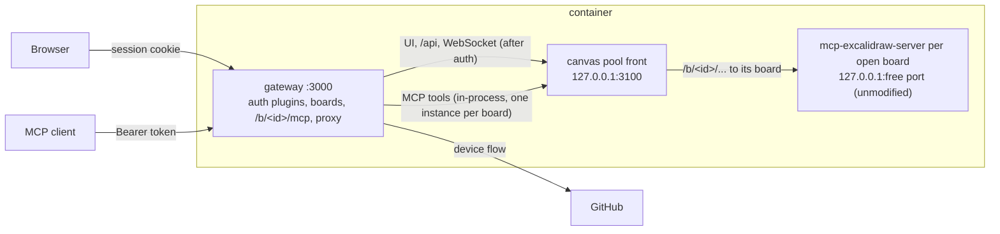

# pizarra

[](https://m8ven.ai/mcp/fullfran-pizarra-18e1i3?s=readme)

A shared handwriting whiteboard for humans and agents. pizarra is an authenticated gateway in front of the unmodified [`mcp-excalidraw-server`](https://github.com/yctimlin/mcp_excalidraw) (pinned to an upstream commit, see [Upstream pin](#upstream-pin)): you draw on the Excalidraw canvas in a browser, and agents (ChatGPT, Claude Code, Codex, …) read and draw on the same board through MCP.

- Several boards (`/b/<id>/`), each its own upstream canvas process, started on first use and stopped when idle; `/` and `/mcp` are board `main`, today's canvas. Editors and viewers per board, invited by GitHub login ([docs/multiuser.md](docs/multiuser.md)).
- `/b/<id>/mcp` (and `/mcp`): upstream's MCP tools over Streamable HTTP, for 2026-07-28 and 2025-era clients, one board per endpoint.
- OAuth 2.1 authorization server: PKCE S256, RFC 9207 `iss`, RFC 8707 `resource`, RFC 9728/8414 metadata, rotating refresh tokens, Client ID Metadata Documents and Dynamic Client Registration.
- Pluggable sign-in (`AUTH_PROVIDERS`): GitHub with the device flow by default (no client secret and no signing secret to configure; the logins in `ALLOWED_GITHUB_LOGINS` are the admins, anyone else needs an invite), and signed board tickets from trusted issuers such as Hagalink Projects. Boards can be embedded by listed origins (`FRAME_ANCESTORS`).
- The canvas UI, REST API and WebSocket are reachable only through the gateway, with a session or a bearer token.

## Architecture



The code is hexagonal, with dependencies pointing inwards (checked by `test/unit/architecture.test.mjs`):

| Path | What lives there |
|---|---|
| `src/auth/` | The auth bounded context: `domain` (pure rules: redirect URIs, return path, PKCE, resources, scopes, allowlist, rate limits, ticket claims), `application` (the `IdentityProvider` port and use cases behind ports: sign-in, authorize, tokens, clients, sessions, tickets), `infrastructure` (JSON token store, SSRF-safe fetch, GitHub device flow, issuer keys, signing secret, env config), `presentation/http` (OAuth and ticket routes, pages, the request authenticator), `plugins` (one file per auth adapter: `github`, `trusted-issuer`). It imports nothing from the gateway or the boards. |
| `src/boards/` | The boards bounded context: `domain` (board ids, owners, roles, who opens what), `application` (create, invite, admit an issuer's board), `infrastructure` (`boards.json`). |
| `src/gateway/` | The board gateway: `domain` (board paths, CSRF, viewer and framing rules), `application` (the access gate, ports for the authenticator, the boards and the canvas), `infrastructure` (canvas pool and its front, upstream supervisor, reverse proxy, per-board upstream MCP, viewer WebSocket filter), `presentation/http` (Express app, MCP, boards API). It imports nothing from auth or boards. |
| `src/composition.ts`, `src/main.ts`, `src/canvas-main.ts` | Composition roots: read config, open the boards, start the canvas pool, wire auth and boards into the gateway. |

## Run locally

```bash
npm run build:upstream   # once per pin: builds vendor/mcp-excalidraw-server-<commit>.tgz
npm ci
npm run build
npm start            # http://127.0.0.1:3000, auth off on loopback
```

On a loopback bind authentication is off unless `AUTH_MODE=oauth`; on any other bind it is required. See [docs/auth.md](docs/auth.md) for every variable, the GitHub OAuth app setup and how to connect clients.

```bash
npm test             # build, unit tests, wire checks (real gateway + real canvas)
npm run typecheck
```

## Deploy

The image runs the gateway and the canvas it supervises:

```bash
docker build -t pizarra .
docker run -p 3000:3000 -v pizarra-data:/data \
  -e PUBLIC_BASE_URL=https://pizarra.example.com \
  -e GITHUB_CLIENT_ID=Ov23xxxxxxxxxxxx -e ALLOWED_GITHUB_LOGINS=FullFran \
  -e TRUST_PROXY=1 pizarra
```

For Dokploy, use [`compose.dokploy.yml`](compose.dokploy.yml) and set `PUBLIC_BASE_URL`, `GITHUB_CLIENT_ID` and `ALLOWED_GITHUB_LOGINS` in its environment; none of them is secret. TLS is terminated by the proxy in front.

Everything durable lives in the `/data` volume: tokens, registered clients, the signing secret and `boards.json` at its root, and each board's canvas (elements, files, snapshots) in `/data/boards/<id>/canvas` with the files written by its MCP file tools in `/data/boards/<id>/files`. A single-canvas volume (`/data/canvas`, `/data/files`) becomes board `main` on the first start. Boards survive restarts of their canvas process, of the gateway and of the container.

## Upstream pin

Upstream is used unmodified, but not from npm: the `2.1.2` npm release has no durable canvas state, while upstream `main` does (unreleased; its `package.json` still says `2.1.2`). The commit is recorded once, in [`upstream.json`](upstream.json). `scripts/build-upstream.sh` clones that commit, checks that `HEAD` is exactly it, runs upstream's own `npm ci && npm run build` and `npm pack`s it into `vendor/` (gitignored), from where `package.json` installs it as a `file:` tarball; the Docker image runs the same script in a build stage. The pack is reproducible, so `package-lock.json`'s integrity hash also checks the image's build. `test/unit/upstream.test.mjs` checks that `upstream.json`, `package.json`, the lockfile and the Dockerfile agree.

To bump it:

1. Put the new full commit SHA in `upstream.json`.
2. `npm run build:upstream && npm install --save-exact ./vendor/mcp-excalidraw-server-<first 12 hex digits>.tgz`
3. `npm test`, then rebuild the image.

Once upstream publishes an npm release that contains durable state, switch back to the registry version (`npm install --save-exact mcp-excalidraw-server@<version>`), drop `upstream.json`, the script, the Docker `upstream` stage and the pin test.

## License

MIT
