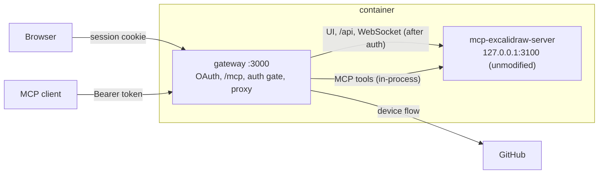

# pizarra

A shared handwriting whiteboard for humans and agents. pizarra is an authenticated gateway in front of the unmodified [`mcp-excalidraw-server`](https://www.npmjs.com/package/mcp-excalidraw-server) (pinned `2.1.2`): you draw on the Excalidraw canvas in a browser, and agents (ChatGPT, Claude Code, Codex, …) read and draw on the same board through MCP.

- `/mcp`: upstream's MCP tools over Streamable HTTP, for 2026-07-28 and 2025-era clients.
- OAuth 2.1 authorization server: PKCE S256, RFC 9207 `iss`, RFC 8707 `resource`, RFC 9728/8414 metadata, rotating refresh tokens, Client ID Metadata Documents and Dynamic Client Registration.
- GitHub sign-in with the device flow: no client secret and no signing secret to configure. Only the logins in `ALLOWED_GITHUB_LOGINS` get in.
- The canvas UI, REST API and WebSocket are reachable only through the gateway, with a session or a bearer token.

## Architecture



The code is hexagonal, with dependencies pointing inwards (checked by `test/unit/architecture.test.mjs`):

| Path | What lives there |
|---|---|
| `src/auth/` | The auth bounded context: `domain` (pure rules: redirect URIs, return path, PKCE, resources, scopes, allowlist, rate limits), `application` (use cases behind ports: sign-in, authorize, tokens, clients, sessions), `infrastructure` (JSON token store, SSRF-safe fetch, GitHub device flow, signing secret, env config), `presentation/http` (OAuth routes, pages, the request authenticator). It imports nothing from the gateway. |
| `src/gateway/` | The board gateway: `domain` (CSRF and path rules), `application` (the access gate, ports for the authenticator and the canvas), `infrastructure` (upstream supervisor, reverse proxy, upstream MCP loader), `presentation/http` (Express app, `/mcp`). It imports nothing from auth. |
| `src/main.ts` | Composition root: reads config, starts the canvas, wires auth into the gateway. |

## Run locally

```bash
npm ci
npm run build
npm start            # http://127.0.0.1:3000, auth off on loopback
```

On a loopback bind authentication is off unless `AUTH_MODE=oauth`; on any other bind it is required. See [docs/auth.md](docs/auth.md) for every variable, the GitHub OAuth app setup and how to connect clients.

```bash
npm test             # build, unit tests, wire checks (real gateway + real canvas)
npm run typecheck
```

## Deploy

The image runs the gateway and the canvas it supervises:

```bash
docker build -t pizarra .
docker run -p 3000:3000 -v pizarra-data:/data \
  -e PUBLIC_BASE_URL=https://pizarra.example.com \
  -e GITHUB_CLIENT_ID=Ov23xxxxxxxxxxxx -e ALLOWED_GITHUB_LOGINS=FullFran \
  -e TRUST_PROXY=1 pizarra
```

For Dokploy, use [`compose.dokploy.yml`](compose.dokploy.yml) and set `PUBLIC_BASE_URL`, `GITHUB_CLIENT_ID` and `ALLOWED_GITHUB_LOGINS` in its environment; none of them is secret. TLS is terminated by the proxy in front.

**Known limit:** upstream `2.1.2` keeps the canvas in memory, so the drawing is lost when the container restarts. Tokens, registered clients and the signing secret persist in `/data`.

## License

MIT
